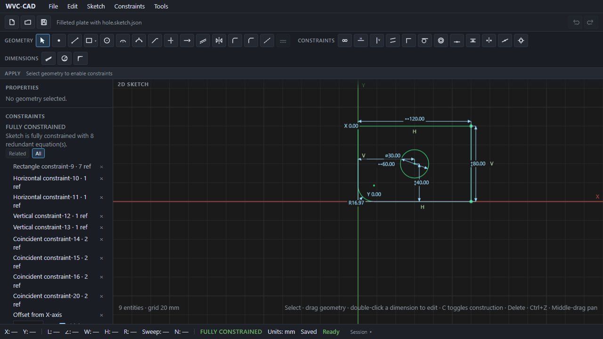

# WVC-CAD

**Weekend Vibe-Coded CAD** — an experimental parametric 2D mechanical sketcher. Internal units are millimetres. The sketch model is the source of truth; React is a view only.

> Not a production CAD product. No affiliation with Autodesk, Dassault Systèmes, Siemens, PTC, or other commercial CAD vendors. Icons and chrome are original — not copied from proprietary products.

## Scripts

```bash
npm install
npx playwright install chromium   # once, for E2E
npm run dev
npm run typecheck
npm run test
npm run test:e2e
npm run lint
npm run build
npm run tauri:dev    # desktop window (needs Rust + WebView2)
npm run tauri:build  # Windows NSIS/MSI installer
```

## Quick start

1. `npm run dev` and open the app (under 5 minutes to first closed profile).
2. Dismiss the first-run tip, or choose **File → Sample: …** for a ready sketch from `public/samples/`:
   - Anchored rectangle — fully constrained 100×50 mm
   - Filleted plate with hole — outer profile + inner circle
   - Capsule slot — slot create tool result
   - Mirrored bracket — L-bracket mirrored about Y
   - Over-constrained line — conflicting lengths (solver status honesty)
3. Or draw: **Rectangle** from the shape flyout (▾), click two opposite corners.
4. Add **Distance** / **Size** dimensions; check **Sketch Analysis** (“Ready for pad”).
5. **File → Save** (overwrite when a file handle exists) or **Export DXF…**.



### Feature status

| Area | Status |
|------|--------|
| Points, lines, circles, arcs, rectangle, polygon, slot | Supported |
| Fillet / chamfer / trim / extend / offset / mirror | Supported (offset: line/chain/loop/circle) |
| Geometric + dimensional constraints + LM solver | Supported |
| DOF / over-constraint honesty | Supported (no fake “fully constrained”) |
| Save / Save As / recent / samples / autosave | Supported |
| DXF | Export only |
| 3D Pad/Pocket / STEP / cloud / AI | Not yet |

See [ROADMAP.md](./docs/ROADMAP.md) for near-term priorities.

## Controls

Menus: **File** | **Edit** | **Sketch** | **Constraints** | **Tools**, plus geometry/constraint toolbars.

- **Select** — click to select; drag points, line ends/body, rect corners/edges, circle/arc centers or rims; Delete/Backspace to remove
- **Point** — click to place; Escape → Select
- **Line** — click start → end (L/∠); continues from the end; Escape cancels unfinished segment; perfect H/V lines get Horizontal/Vertical constraints
- **Rectangle / Polygon / Slot** — click the shape flyout (▾) to pick rectangle, N-gon, or capsule slot
- **Circle** — click center → click radius (R); drag center to move; drag rim to resize
- **Arc** — center → start → end (CCW sweep; R + Sweep); drag center to move; drag arc to resize
- **3-pt Arc** — start → through → end (circle through three points)
- **Tangent Arc** — near a line end → arc end
- **Trim** — click the portion of a line to remove (needs a crossing line or world axis)
- **Extend** — click near a line end to grow to the nearest crossing line or world axis
- **Offset** — parallel offset of a line, open chain, closed loop, or concentric circle
- **Mirror** — select geometry, then click a line or world axis; copies geometry + remappable constraints
- **Fillet** — click two lines (or adjacent rectangle edges), then click to set fillet radius
- **Chamfer** — click two lines (or adjacent rectangle edges), then click to set chamfer distance
- **Construction** — toolbar toggle creates dashed reference geometry; **Toggle Constr.** / `C` (with selection) flips selected entities
- **Coincident** — pick first point/endpoint/center, then second point or a line; partners stay together when dragged
- **Horizontal / Vertical** — click a line, or two points/endpoints/centers; stays H/V while dragging; conflicting constraints are rejected
- **Parallel / Perpendicular / Tangent / Concentric / Midpoint / Equal / Symmetric / Point on object / Fix** — constraint tools (Constraints menu / toolbar)
- **Dimensions** — Distance (smart), Size (circle ⌀ / Shift=R; arc R), Angle. Edit in the Constraints panel or double-click a canvas label
- **File** — New (Ctrl+N), Open (Ctrl+O), Save / Save As, Open recent, **Sample: …**, Export DXF…
- **Autosave** — dirty sketches autosave to a local recovery slot; restore prompt after crash/reload
- **Undo / Redo** — Ctrl+Z / Ctrl+Y (or Ctrl+Shift+Z)
- Snaps: grid, origin, endpoints/points, midpoints, centers, intersections, on-entity; temporary H/V (+ grid compose)
- Middle-drag or Alt+left-drag pans · wheel zooms around the cursor
- **Sketch Analysis** — closed profiles + “Ready for pad” topology gate (does not fake DOF)

## Windows installer

**Tauri 2** scaffold in `src-tauri/` (not Electron). Needs Rust for `tauri:dev` / `tauri:build`. Details: [PACKAGING.md](./docs/PACKAGING.md).

## Current limitations

- Offset of mixed line+arc closed profiles falls back to single-segment / is skipped for polyline rebuild
- DXF is export-only (no import; constraints not in DXF)
- Dense solver is comfortable for tens–low hundreds of constraints (see [ARCHITECTURE.md](./docs/ARCHITECTURE.md))
- Residual/column scaling deferred (ADR-052); see [PROGRESS.md](./docs/PROGRESS.md) and [assessments.md](./docs/assessments.md)
- Tauri installer requires a local Rust toolchain; Windows builds are unsigned until code signing is configured (see [PACKAGING.md](./docs/PACKAGING.md))

## License

MIT — see [LICENSE](./LICENSE). Third-party notices: [THIRD_PARTY.md](./THIRD_PARTY.md).

## Docs

| File | Role |
|------|------|
| [PROGRESS.md](./docs/PROGRESS.md) | Live checklist |
| [ROADMAP.md](./docs/ROADMAP.md) | Near-term public priorities |
| [ARCHITECTURE.md](./docs/ARCHITECTURE.md) | Layers and edit pipeline |
| [DECISIONS.md](./docs/DECISIONS.md) | ADRs |
| [TEST_PLAN.md](./docs/TEST_PLAN.md) | Test coverage |
| [CONTRIBUTING.md](./CONTRIBUTING.md) | How to contribute |
| [SECURITY.md](./SECURITY.md) | Vulnerability reporting |
| [AGENTS.md](./AGENTS.md) | Agent/contributor roadmap |
| [assessments.md](./docs/assessments.md) | Historical architecture snapshot |
| [PACKAGING.md](./docs/PACKAGING.md) | Tauri 2 installer notes |
| [THIRD_PARTY.md](./THIRD_PARTY.md) | Dependency licenses |
